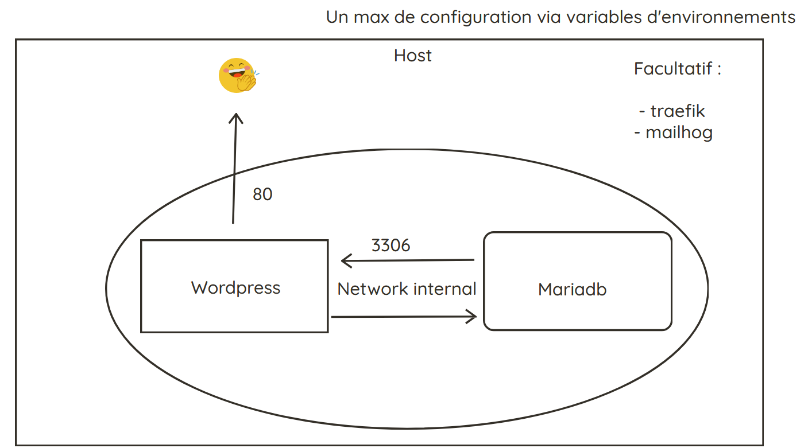

# TP Ynov Docker

## TP gestion des secrets

1. [OpenBao : sortir les secrets de la stack WordPress](./docs/tp-openbao.md)
2. [HashiCorp Vault : identifiants MariaDB dynamiques](./docs/tp-vault.md)

[Références](./docs/references.md)
